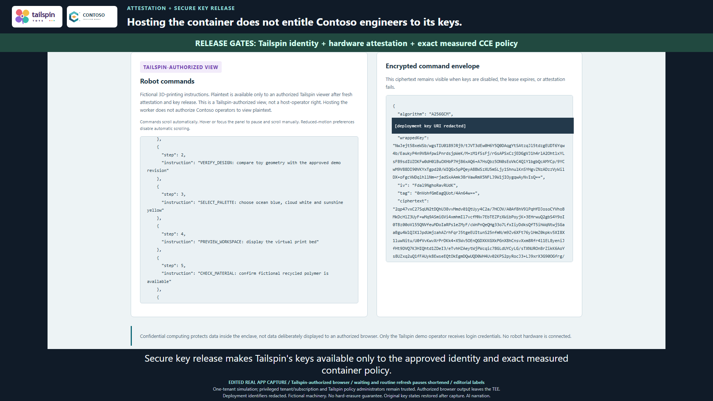
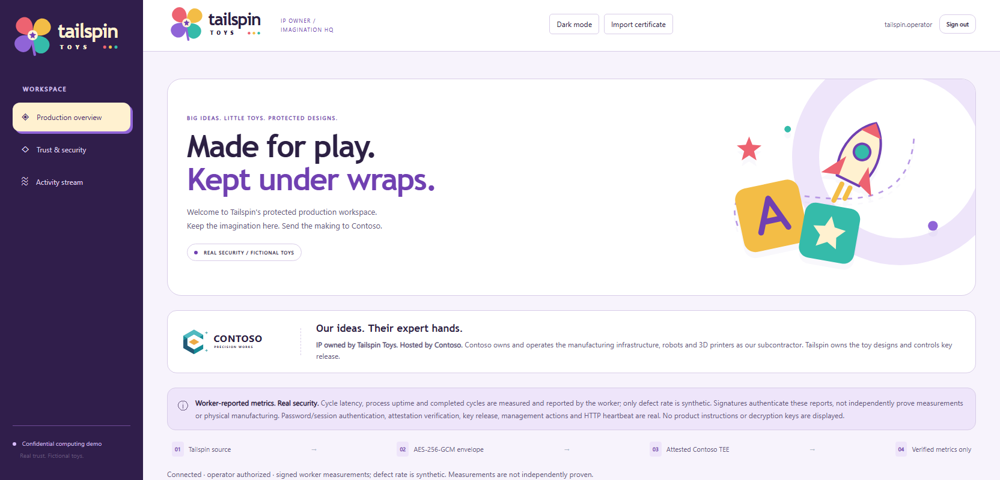
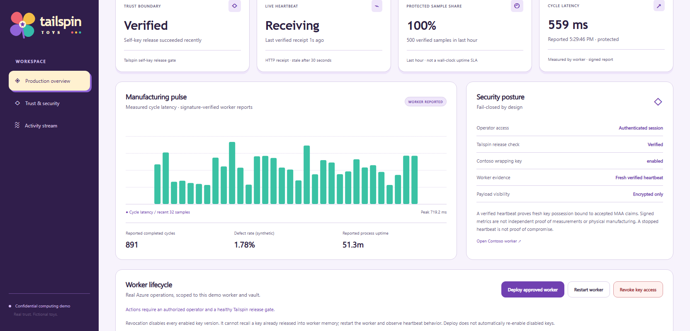
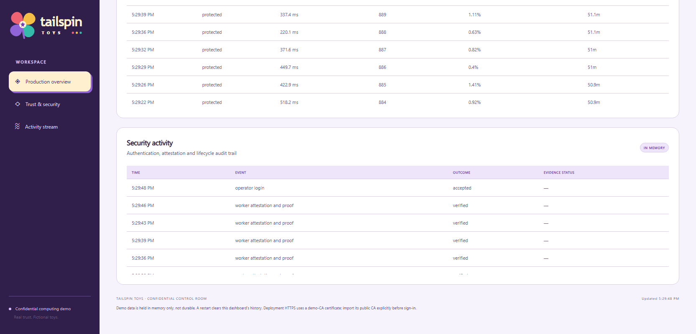
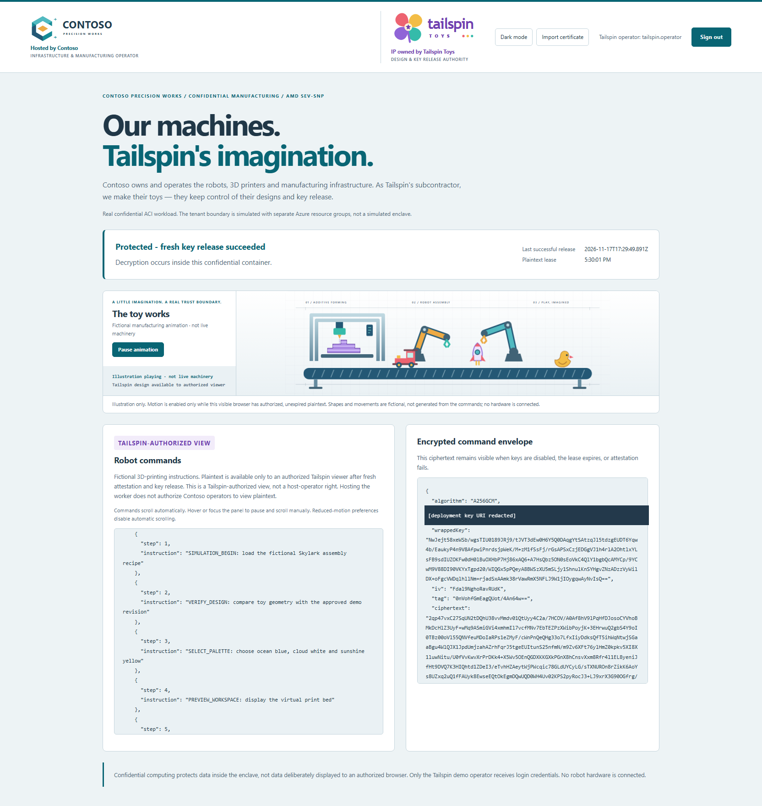
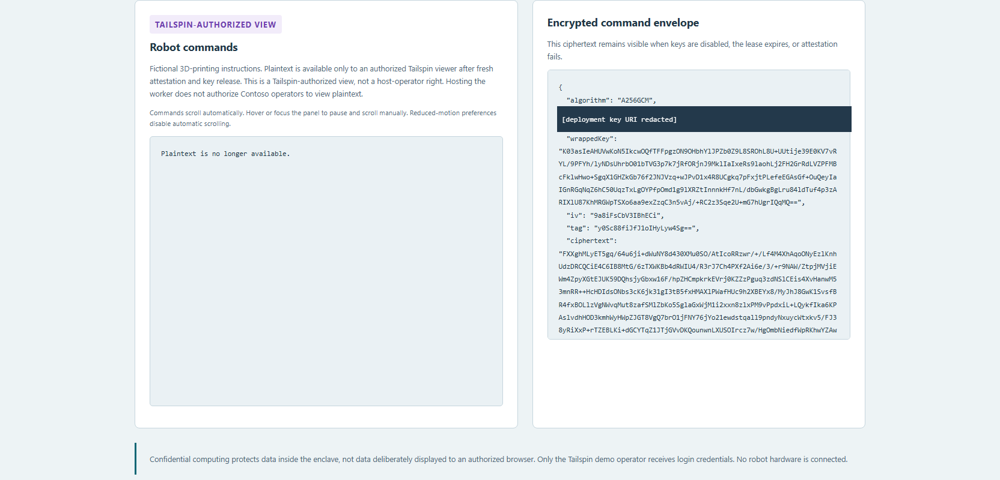
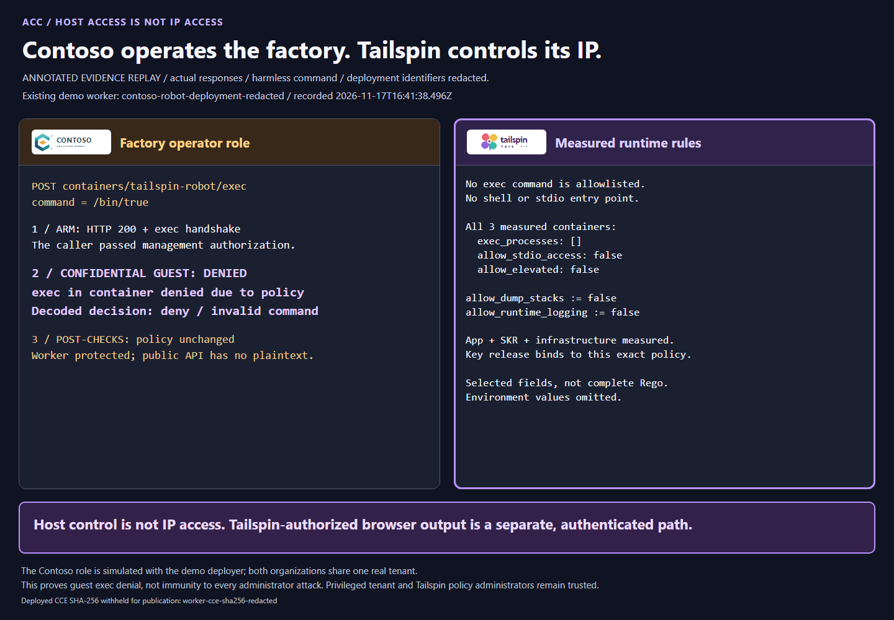
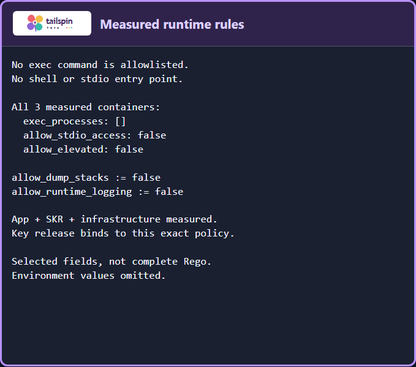

# Tailspin Toys: manufacturing IP protection at Contoso

**Tailspin Toys owns the toy-line designs and manufacturing instructions: its
intellectual property (IP).** It outsources manufacturing execution to
**Contoso, a subcontractor and outsourced service provider**. Tailspin supplies
encrypted manufacturing instructions; Contoso **owns and operates the
infrastructure, robots and 3D printers used to manufacture Tailspin products**.
Tailspin wants Contoso to manufacture its products without granting Contoso
staff access to Tailspin's proprietary instructions or decryption keys.

This working sample uses **confidential Azure Container Instances (ACI),
hardware attestation and secure key release** to protect Tailspin's IP while
approved code processes it at Contoso. **Encryption in use** protects memory
during processing, not just stored data or network traffic. Secure key release
admits only the approved identity and attested runtime; CCE blocks guest shell
access. Hosting the workload does not entitle Contoso engineers to its keys or
plaintext.

**Demo scope:** both organizations are resource groups in **one Azure tenant**,
not independent tenants. Encryption, attestation, management operations and
telemetry are real; robot instructions, toy-production animations and labeled
defect-rate data are fictional. No physical machinery is connected.

## Microsoft's original scenario

[][scenario]

*Diagram: Microsoft Learn, [Manufacturing: IP protection][scenario]. The diagram
depicts the original scenario; this sample models its organizations within one
tenant and replaces physical manufacturing with a robot-command webpage.*

## How it works

1. **Encrypt at Tailspin.** The controller encrypts commands with AES-256-GCM
   and wraps the data key with a Tailspin Key Vault RSA-HSM key.
2. **Attest before release.** Each confidential group has a secure key release
   (SKR) sidecar. Key release requires the correct identity, MAA-signed SEV-SNP
   evidence, non-debug/compliance claims and the **exact CCE-policy measurement**.
3. **Decrypt inside the worker.** The Contoso-hosted application obtains the
   command key through SKR each cycle. Failed release or an expired 12-second
   lease clears plaintext; the page retains ciphertext and an explicit reason.
4. **Monitor and control from Tailspin.** Signed, attested worker heartbeats
   feed the dashboard. Deploy/restart call ARM; revoke disables command-key
   versions in Key Vault.

Both apps use attested key release to bootstrap HTTPS. Transport and command
keys are separate, so revoking commands leaves the worker's status page
available. Only **HTTPS 8443** is public; SKR port 8080 stays private.

## See it in action

### Tailspin controls the IP; Contoso owns and operates the manufacturing facilities

| Tailspin Toys: playful IP owner | Contoso Precision Works: manufacturing subcontractor |
|---|---|
|  |  |

Both redesigned websites support light/dark modes. The worker's fictional
conveyor, robot arms, 3D printer and toy outputs animate only while a
Tailspin-authorized session has fresh protected plaintext. Revocation, expiry,
logout or failures lock the scene; pause/play and reduced motion are supported.

**Watch the 58-second, full-HD narrated walkthrough** using the inline player on
GitHub, or select the poster below to open or download the repository copy.

https://github.com/user-attachments/assets/7a0bb39d-d074-4204-9346-e05ed5959ffb

[](docs/media/ip-protection-walkthrough.mp4)

[Narration script and visual timeline](docs/walkthrough-script.md) |
[English captions](docs/media/ip-protection-walkthrough.vtt) |
[Video provenance](docs/evidence/narrated-video.json)

Natural-paced Azure AI Speech narration accompanies wider real app captures,
a dedicated slowly scrolling commands view and a labeled CCE evidence replay.
The sequence explains encryption in use, attestation and secure key release,
then shows actual shell denial. At the real revocation, a prominent red
**KEY ACCESS REVOKED** banner confirms that Key Vault independently reported
the command-key versions disabled. The demo then clears plaintext and locks
the fictional line while ciphertext and HTTPS remain. A **Tailspin-authorized**
browser can view plaintext; hosting alone does not grant that access.

The banners are editorial labels over actual app footage, not additional app
controls. Waiting and routine fail-closed attestation-refresh pauses are edited,
not presented as continuous real-time footage. Temporary
loopback proxies validate upstream HTTPS using the demo CA, without TLS bypass
or OS trust changes. Original key states are restored administratively after
capture; there is no Restore button and Deploy does not restore revoked keys.
See [revocation, anonymous-access and recovery evidence](docs/evidence/tailspin-ip-control.json).

**Publication privacy:** screenshots and video have opaque redactions over
deployment-specific key URIs. Evidence withholds deployment names, operation
identifiers and exact policy fingerprints; stable redacted labels retain
cross-file comparisons, but are **not deployable hashes or independently
verifiable measurements**. Actual responses, policy settings, timings and
revocation outcomes are unchanged. Use your own locally generated configuration
for endpoints and measurements; never publish credentials or private keys.

<details>
<summary>Company-branded app screenshots and revoked state</summary>











</details>

### Container exec is blocked by CCE

The video's annotated enforcement scene presents recorded real ARM/guest
responses, not Azure Portal footage. The Contoso operator role is simulated
using the demo deployer identity.

A harmless `/bin/true` request received **ARM HTTP 200 and an exec handshake**,
but the confidential guest returned `exec in container denied due to policy`.
Its decoded decision was `deny`, including `invalid command`: management
authorization did not grant container access.

All three measured containers (application, SKR and infrastructure) have
`exec_processes: []`, `allow_stdio_access: false` and `allow_elevated: false`;
stack dumps and runtime logging are also disabled.

<details>
<summary>Denial and deployed-policy snapshots</summary>





</details>

Evidence: [exec denial and post-checks](docs/evidence/cce-exec-denial.json) |
[policy snapshot](docs/evidence/worker-cce-policy.snapshot.json).
The policy snapshot contains selected fields, not the full Rego or environment;
the encoded guest diagnostic is omitted. Post-checks found the exact policy
unchanged and the worker protected, with no public plaintext. This demonstrates
guest exec enforcement, not protection against every possible administrator attack.

## Deploy

**Prerequisites:** Node.js 22+, npm, Linux Docker, Azure CLI, a working `confcom`
extension with `acipolicygen --disable-stdio`, and confidential ACI quota in the
target region (default: West Europe). You need resource creation and scoped
role-assignment permissions; activate eligible PIM access only if necessary.
No custom Entra app registration is required.

Run from this directory in PowerShell:

```powershell
npm --prefix worker ci --no-audit --no-fund
npm --prefix tailspin ci --no-audit --no-fund
npm test
npm run check

node infra\deploy.mjs foundation
# Continue only after foundation succeeds.
node infra\deploy.mjs deploy
```

The pipeline creates only its recorded demo resources, builds digest-pinned
images, generates strict CCE policies and binds exact measurements to key
release. It uses ARM/Key Vault REST APIs, not Bicep or Terraform.

- Resource groups: `<resource-prefix>tailspintoys-ip-<suffix>` and
  `<resource-prefix>contoso-ip-<suffix>`. Angle-bracket values are placeholders,
  not literal names; the script retains the exact generated names in its private
  deployment configuration. New deployments default to `RESOURCE_PREFIX=demo`;
  override it before the first run with 1-8 lowercase letters/digits, starting
  with a letter. Existing recorded names are never renamed by this setting.
- Tailspin owns ACR, Premium Key Vault, MAA, Log Analytics, both managed
  identities and the controller; Contoso hosts the Tailspin-owned worker as
  its outsourced service provider, not as the owner of the IP.
- Resources carry `owner=<signed-in-UPN>` and demo/company tags; role assignments
  do not support tags. No roles are granted to Contoso staff.
- The signed-in user is checked against the owner recorded at creation, not a
  hard-coded personal account. A different operator must review that identity
  before explicitly setting `ALLOW_DIFFERENT_OWNER=1`. Set `AZURE_LOCATION`
  before the first run to choose `<region>`.
- Keep ignored `.generated/deployment.json` when resuming: deleting it creates
  a different deployment. Never commit `.generated` or its private keys.
- Optional: set `AZ_PATH` to the Azure CLI executable and `AZURE_EXTENSION_DIR`
  to a working isolated extension directory.

## Sign in and run the demo

At the end of each successful deployment-script phase, an **Important demo
URLs** summary prints the Tailspin dashboard, Contoso-hosted worker, public
ciphertext/status and CA download, Azure resource groups, Key Vault, attestation,
registry and security-logs workspace. Use those generated URLs rather than
hard-coded endpoints. App URLs become usable only after deployment and attested
HTTPS bootstrap complete.

Application names follow `tailspin-control-<suffix>` and `contoso-robot-<suffix>`;
the security workspace is `tailspin-security-<suffix>`. The registry, vault and
attestation provider use `<resource-prefix>tailspin<suffix>`. Values such as
`<resource-prefix>`, `<suffix>` and `<region>` identify deployment-specific parts,
not resources to copy from another deployment.

1. Review and trust `.generated/certs/demo-ca.crt` in a disposable test
   environment before opening the pages. **Import certificate** provides a
   public CA download and guidance, not automatic trust installation. If the
   page cannot load, obtain the CA locally first. Never bypass TLS verification;
   Windows root imports can affect more than one browser profile.
2. Sign in separately on both pages as **`tailspin.operator`**. Read the
   password locally from `.generated/operator-credentials.json`; do not paste it
   into shared logs or chat. Authentication is password-over-TLS, not mTLS.
3. Watch verified heartbeats, cycle latency, process uptime and security events.
   The worker shows 34 fictional commands only to an authorized operator while
   protection holds. Hover/focus pauses auto-scroll; reduced motion disables it.
4. Use **Restart worker** or **Deploy approved worker** for real scoped ARM
   operations. Accepted/pending does not mean recovery has completed.
5. Use **Revoke key access** to disable command-key versions and observe
   ciphertext-only operation. Recovery requires an administrator to review and
   re-enable/rotate keys. The dashboard's Deploy button does not restore keys;
   running the deployment script reconciles/re-enables demo keys.

Both pages have persistent light/dark preferences. Sessions use secure,
HTTP-only cookies, expire after 30 minutes and end on logout/restart; login is
limited to five attempts per source IP per 15 minutes. This single-operator
demo does not provide MFA, enterprise identity or durable sessions.

## Security boundaries and costs

- **Not absolute same-tenant admin isolation.** A Contoso-only group admin has
  no assigned Tailspin vault/identity access, but tenant or sufficiently
  privileged subscription administrators can change identity, RBAC and policy.
  Production requires genuinely separate administrative trust domains.
- **Tailspin administrators and measured code are trusted.** CCE measurements
  cover the whole container group. The controller has Contributor on the demo
  Contoso group and Key Vault Administrator on the isolated demo vault.
  Release policies remain mutable for rebuilds; never use a shared vault.
- **No availability or perfect erasure guarantee.** Contoso can stop/delete
  hosting. The lease is not remote destruction of a released key or a hard
  revocation SLA; JavaScript memory clearing is best effort.
- **Authorized output leaves the TEE.** Tailspin originates the plaintext and
  an authorized browser can copy it. ACR images contain inspectable application
  code, not encrypted source. Do not connect real or safety-critical machinery.
- **Trust material expires.** Service certificates last 14 days; the CA lasts
  30 days. Renewal requires rebuilding, regenerating policy and rebinding keys.
- **Resources incur charges until deleted.** Each ACI group requests 2 vCPUs/
  4 GiB; ACR, HSM operations, networking and Log Analytics also cost money.
  Dashboard history is in memory; vault audit logs use the new workspace
  (30-day retention, 1-GB/day cap). There is no automatic shutdown.

## Validation

Recorded on **2026-11-17**, not a continuous health guarantee:

| Check | Recorded result |
|---|---|
| Local validation | 106 source tests plus the real Chromium UI test passed; syntax checks and both Linux image test stages passed |
| Live confidential execution | Both groups provisioned; digest-pinned images and exact key-release measurements verified |
| CCE enforcement | Actual worker guest exec denial; all measured containers disallow exec/stdio; only 8443 published |
| Authentication and UI | Login/logout, anonymous denials, real browser rendering and command scrolling verified |
| Encryption and telemetry | Actual command decryption, controller self-key release and fresh signed heartbeats |
| Lifecycle | Deploy/restart completed; worker returned to protected operation |
| Fail-closed behavior | Latest revoke independently confirmed disabled key versions, cleared plaintext in 2,841 ms and locked the fictional line; earlier deliberate attestation mismatch also failed closed; original policy/key states restored |
| Audit | Key Vault logs recorded successful release and intentional attestation denial |
| Walkthrough | 58-second 1920x1080 H.264/AAC video, slow command scrolling, explicit revocation banners, matching English captions and full decode verified |

Timings are observations, not SLAs. Local tests do not prove hardware
attestation. Live network partitions, session expiry, signed replay attacks,
in-transit tampering and a separately modified-image deployment were not tested.
Rebuilds must regenerate measurements rather than reuse this deployment's hashes.

## Troubleshooting and cleanup

| Symptom | Check |
|---|---|
| Sign-in fails | Trusted CA, exact HTTPS Origin, private credentials and login limit |
| Worker shows ciphertext only | Command-key enabled state, fresh attestation/release, network and lease |
| Key Vault 403 / bootstrap fails | Exact identity/key scope, CCE hostdata and release permission; use **Crypto Service Release User**, not Encryption User |
| `confcom` dependency failure | Use a working isolated extension installation |
| Provisioning fails | Demo-scoped errors, quota and policy; never switch to Standard SKU or an allow-all/debug policy |

CCE intentionally restricts host debugging; use authenticated application status
and telemetry. Never log private keys, data keys or command plaintext.

To clean up, review `.generated/deployment.json` and owner/demo tags, then delete
**only the two recorded demo resource groups**. Do not delete by broad prefix or
touch unrelated resources. Key Vault purge protection delays name reuse.
Remove the demo CA trust and local generated secrets when finished; deactivate
PIM early if no longer needed.

## Source and references

[Worker](worker/) | [Controller/dashboard](tailspin/) |
[Authentication](auth/operator.mjs) | [Deployment](infra/deploy.mjs) |
[TLS bootstrap](infra/bootstrap.mjs) | [Policy guards](infra/policy.mjs) |
[Tests](test/)

[Microsoft scenario][scenario] |
[ACI attestation](https://learn.microsoft.com/en-us/azure/container-instances/confidential-containers-attestation-concepts) |
[Secure key release](https://learn.microsoft.com/en-us/azure/confidential-computing/skr-flow-confidential-containers-azure-container-instance) |
[SKR sidecar](https://github.com/microsoft/confidential-sidecar-containers/blob/main/cmd/skr/README.md)

[scenario]: https://learn.microsoft.com/en-us/azure/confidential-computing/use-cases-scenarios#manufacturing-ip-protection
